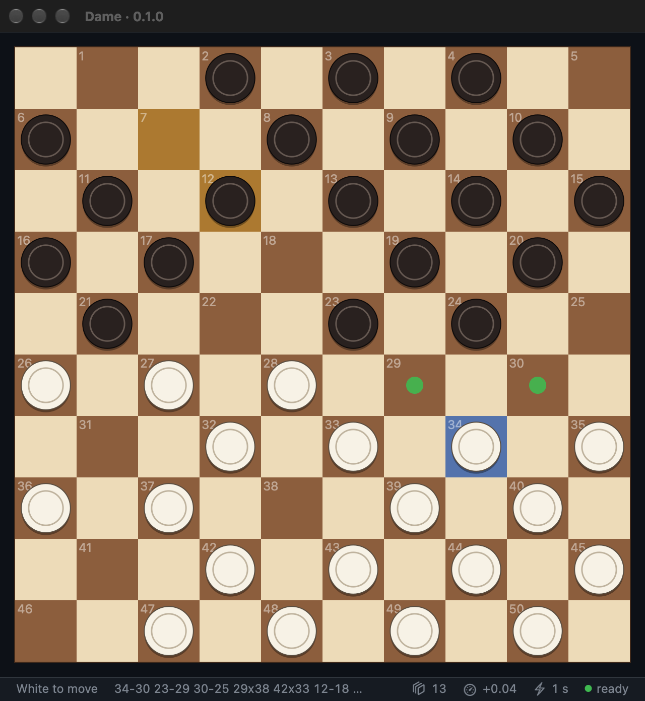

# macOS app

`Dame.app` is a native macOS front end, written in Rust against AppKit with
[objc2](https://github.com/madsmtm/objc2). It draws the board, checks your
moves with the `dame` crate, and runs the engine as a separate process that it
talks to over the [Hub protocol](cli.md#in-a-gui-the-hub-protocol), so a
busy or crashing engine never freezes the window.
It needs a Mac with Apple silicon and macOS 12 or later.



## Install

Every [GitHub release](https://github.com/KarelZe/dame-rs/releases/latest)
has a disk image, `Dame-<version>.dmg`, for Macs with Apple silicon. Open it
and drag `Dame.app` onto `Applications`.

The app is signed ad hoc, not with an Apple Developer ID, so macOS blocks it
the first time. Open it once, then choose **Open Anyway** under
System Settings → Privacy & Security. Or clear the download flag in a
terminal:

```bash
xattr -dr com.apple.quarantine /Applications/Dame.app
```

## Build and run

Build the app from a checkout:

```bash
scripts/bundle-macos.sh        # builds target/release/Dame.app
open target/release/Dame.app
```

`scripts/dmg-macos.sh` packs the bundle into `target/release/Dame-<version>.dmg`,
as the release does. The app supports Apple silicon only; on an Intel Mac,
`bundle-macos.sh` still builds it for local use.

The bundle holds both binaries: `dame-macos` (the app) and `dame` (the
engine). During development, `cargo run --release -p dame-macos` works too,
once `cargo build --release -p dame-cli` has put `dame` next to it.

The app icon is drawn in `crates/dame-macos/assets/icon.svg`; after editing
it, `scripts/macos-icon.sh` renders `icon.png` (needs ImageMagick).

The app looks for the engine in this order:

1. the `DAME_ENGINE` environment variable, which may name any Hub engine
   (it is started with the argument `hub`);
2. `dame` next to the app's executable;
3. `dame` on the `PATH`.

Without an engine the app still works as a board for two players.

## Opening book

Choose **File → Open Opening Book…** (⌘O) to pick a book: a PDN file of
games, whose first ten moves the engine follows (see
[Opening book](design.md#opening-book)). The app restarts the engine with the
book and keeps the game; from then on the engine plays book moves while the
position is in the book. The app remembers the book across launches.
**Clear Opening Book** turns it off.

To get started, build `~/draughts/mobydam.pdn` from Moby Dam's games as shown
in [Getting games](cli.md#getting-games), then open it here; in the file
dialog, ⇧⌘G lets you type the path.

While a book is open, the status bar shows a book icon with the book depth:
how many plies (half-moves) of each game the engine follows. Its tooltip names
the book. Click it, or use **File → Book Depth**, to choose 8 to 40 plies; the
engine restarts to rebuild the book, and the app remembers the depth.

The app always tells the engine which book and depth to use, so `DAME_BOOK`
and `DAME_BOOK_PLIES` have no effect on it. If the file cannot be loaded, the
status bar shows the engine's error.

## Playing

Click a piece, then its destination; legal destinations are marked with a dot.
When two captures start and end on the same squares, the status bar asks you
to click one of the pieces to take, which picks the route. You can also click
that piece before the destination.

The status bar at the bottom shows whose turn it is and the first six moves of
the engine's expected line on the left (the tooltip shows all of it). On the
right are the search depth (layers icon), the score in men from White's point
of view (gauge icon), the [book depth](#opening-book) (book icon, click to
change), the time per move (lightning icon) and the engine's state (green:
ready, yellow: thinking). Rest the pointer on an item for an explanation; the
engine's name and version are in the tooltip of its state. **Dame → About
Dame** shows the app version and links to the project on GitHub.

| Menu   | Command          | Shortcut | |
|--------|------------------|----------|---|
| File   | Open Opening Book… | ⌘O     | the engine plays from this book; see [Opening book](#opening-book) |
| File   | Clear Opening Book |        | the engine searches every move |
| File   | Book Depth       |          | 8 to 40 plies of each book game; also by clicking the book icon in the status bar |
| Game   | New Game         | ⌘N       | |
| Game   | Move Now         | ⌘E       | stops the engine's search, or lets it move for the side to move |
| Game   | Reload Engine    | ⌘R       | restarts the engine process and keeps the game, e.g. after rebuilding `dame` |
| Game   | Engine Plays …   |          | Black, White, both, or nobody (two players) |
| Game   | … Seconds per Move |        | 1, 3, 10 or 30 seconds per engine move |
| Edit   | Take Back Move   | ⌘Z       | takes back your last move and the engine's reply |
| Edit   | Copy Position    | ⌘C       | the position as FEN |
| Edit   | Copy Moves       | ⇧⌘C      | the game in PDN move notation |
| Edit   | Paste Position   | ⌘V       | sets up a FEN or Hub position |
| View   | Flip Board       | ⌘F       | |
